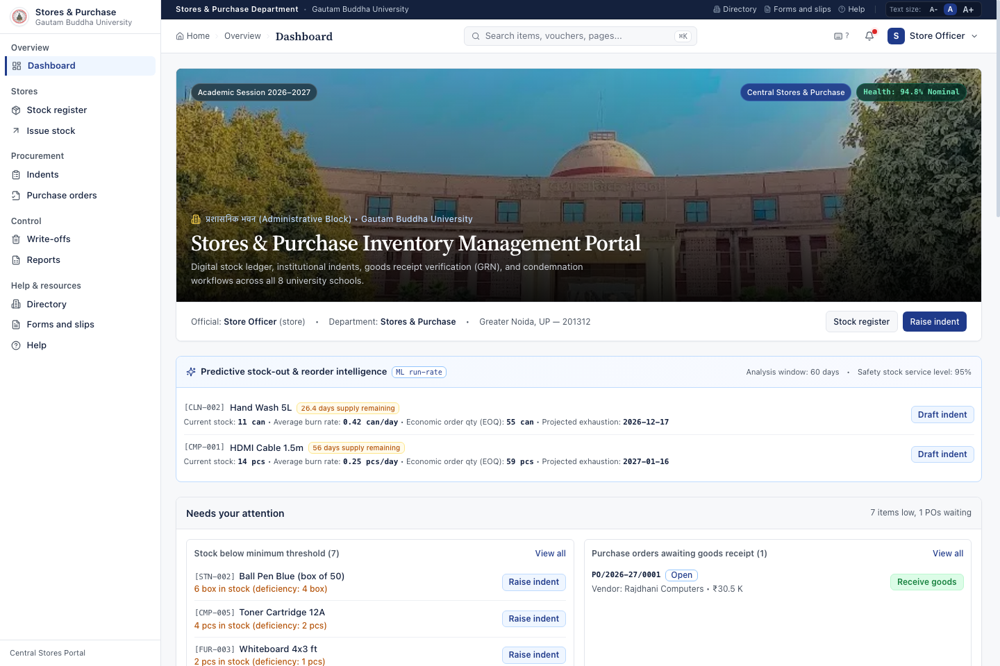
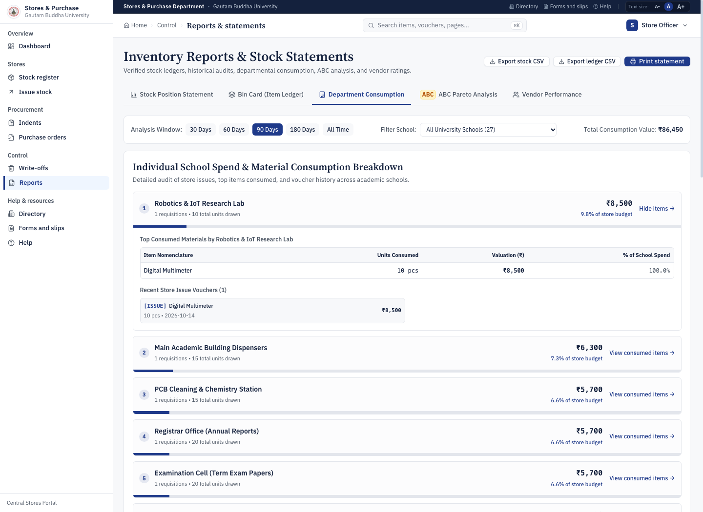
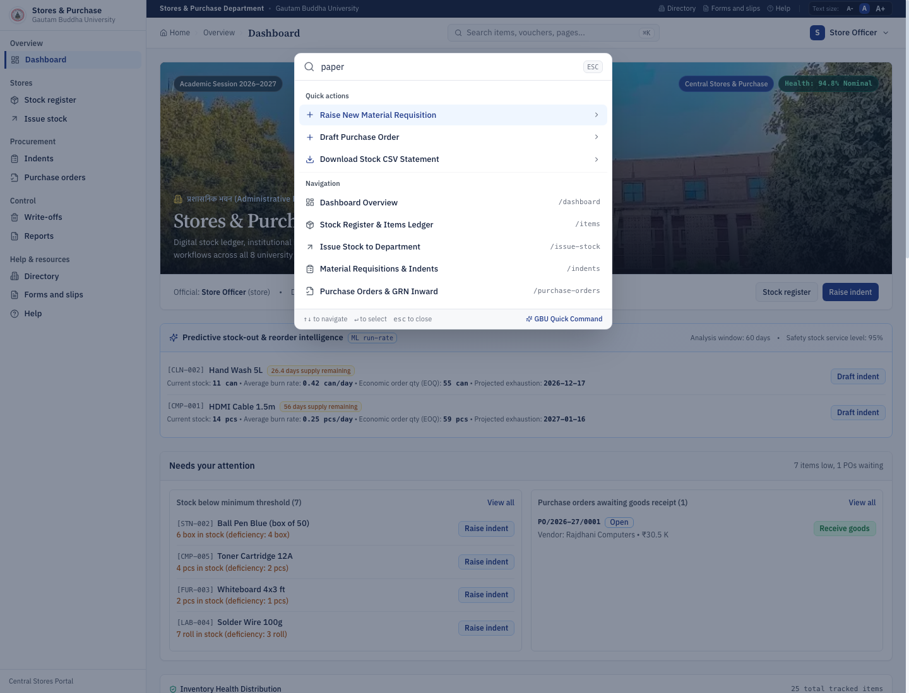
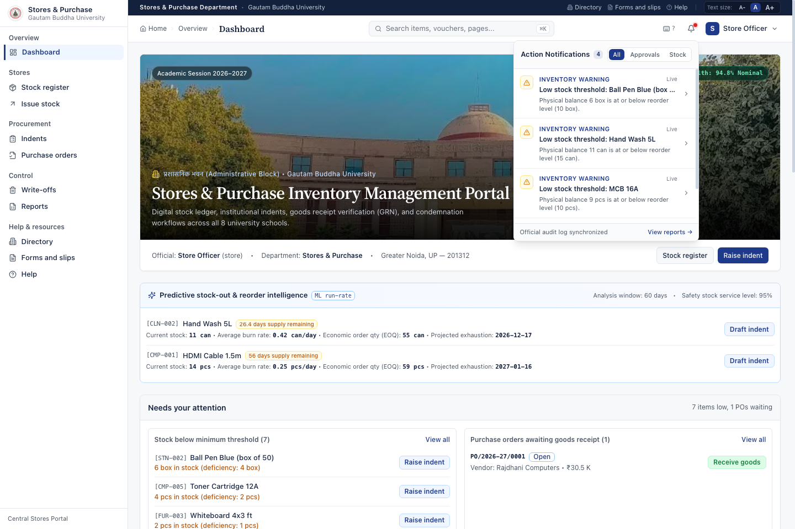
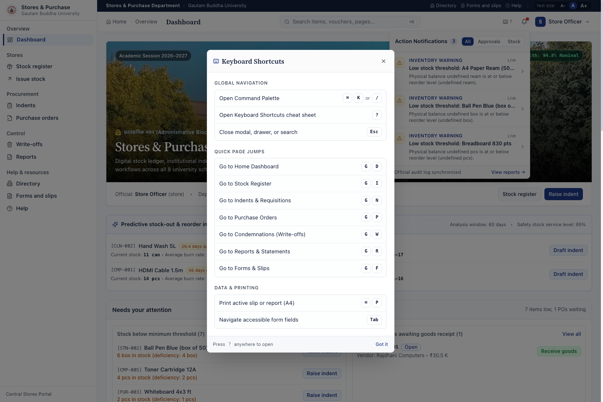
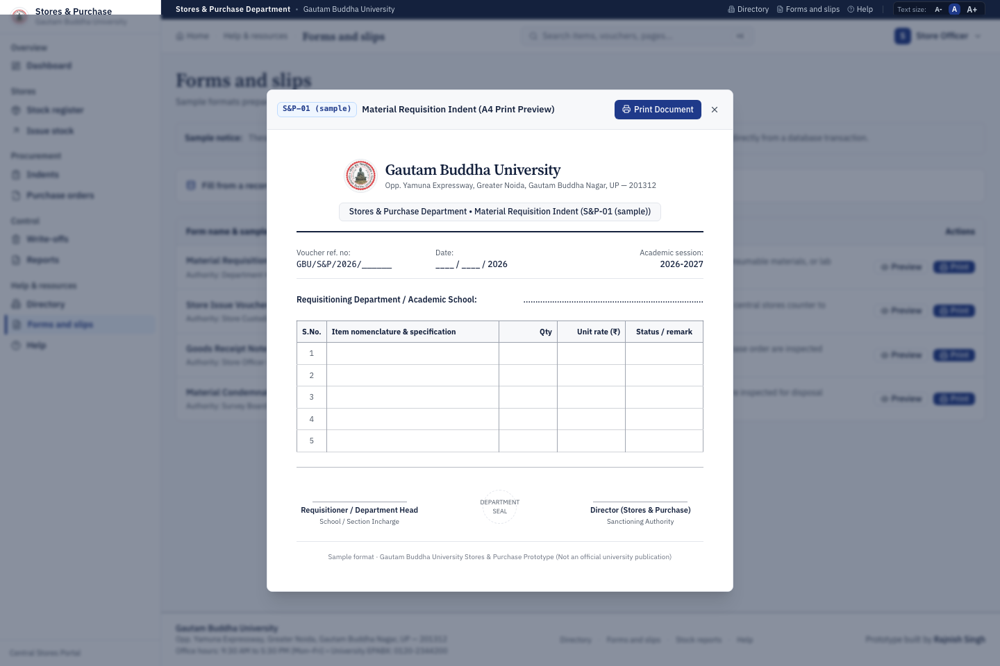
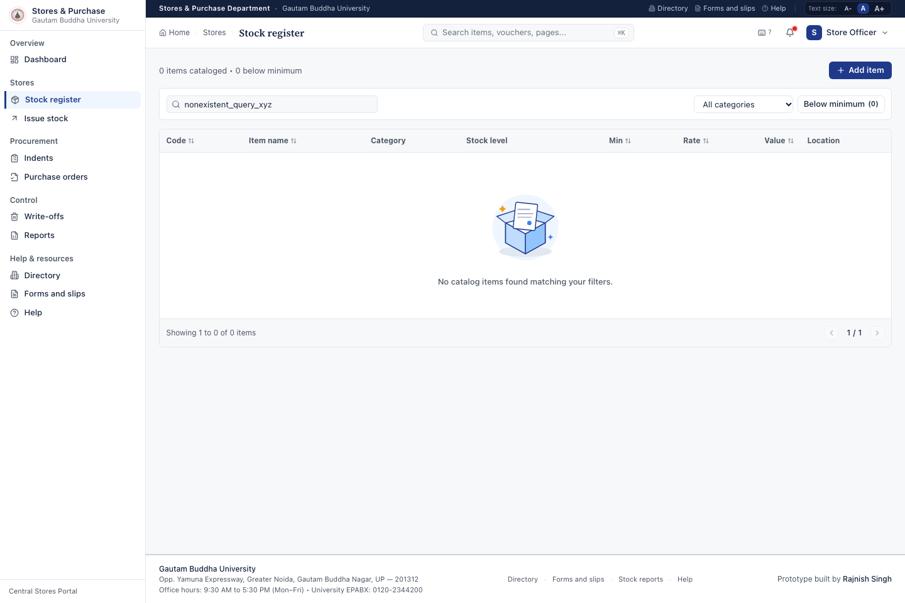
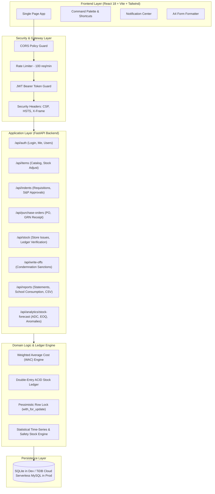
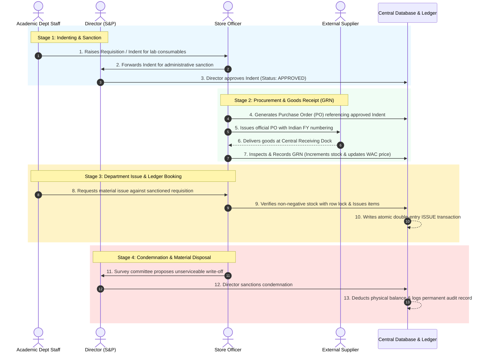

# Gautam Buddha University (GBU)
## Central Stores & Purchase (S&P) Department — Digital Inventory Management System

[](https://fastapi.tiangolo.com)
[](https://react.dev/)
[](https://tailwindcss.com/)
[](https://www.sqlalchemy.org/)
[](backend/test_flows.py)
[](https://ui.shadcn.com)

A production-grade, enterprise digital inventory management prototype designed for the **Stores & Purchase (S&P) Department** of **Gautam Buddha University (GBU)**, Greater Noida, UP.

It governs the full institutional material lifecycle across all 8 academic schools and administrative departments: **Stock Cataloging**, **Multi-Level Indenting**, **Purchase Orders & Goods Receipt Note (GRN)**, **Departmental Store Issuance**, **Survey Committee Condemnations (Write-offs)**, **School-Wise Material Consumption Analytics**, and **Statistical Time-Series Stock-Out Forecasting**.

> **Honesty & Prototype Notice:**  
> This digital portal is an engineering demonstration prototype designed and developed by **Rajnish Singh**. All form templates (e.g., `S&P-01` to `S&P-04`), voucher numbers, and seed records are realistic sample formats prepared to demonstrate enterprise software engineering standards. University EPABX: `0120-2344200`.

---

## Visual Tour & Key Interfaces

### 1. Institutional Executive Dashboard & Panoramic Landmark Hero
Featuring the authentic architectural landmark of Gautam Buddha University (**प्रशासनिक भवन / Administrative Block**), real-time inventory health tracker, statistical run-rate stock-out forecast alerts, and high-density KPI cards with micro-sparklines.



---

### 2. School-Wise Material Consumption & Requisition Drill-Down
Department-by-department material consumption tracking across university schools (SoICT, SoE, SoBT, SoM, SoVSAS, SoBAS, SoLJ&G, Central Admin). Executives can drill down to item-level nomenclature, quantity drawn, monetary valuation (₹), budget percentage share, and historical issue voucher slips.



---

### 3. Shadcn Command Palette (`⌘K` / `/`)
Instant fuzzy keyboard launcher enabling zero-latency item search, active quantity inspection, direct page jumps, and fast action triggers (Raise Indent, Draft PO, Export Ledger).



---

### 4. Real-Time Action Notifications & Low-Stock Alerts
Header notification popover aggregating threshold alerts (e.g. items falling below reorder level) and pending administrative approvals (indents and condemnation sanctions).



---

### 5. Keyboard Navigation & Shortcuts Cheat Sheet (`?`)
Full accessibility and ergonomic power-user shortcuts dialog supporting quick keyboard-driven navigation (`G+D`, `G+I`, `G+P`, `G+R`, `⌘K`, `Esc`).



---

### 6. Standard A4 Printable University Slips (`S&P-01` to `S&P-04`)
Standardized A4 university store voucher formats with auto-fill from existing database records (Indents, Store Issues, Purchase Orders, and Write-off Sanctions) with clean print preview and browser print integration.



---

### 7. Storyset Vector Empty States & Modern Design Ergonomics
Handcrafted SVG vector illustrations for zero-result queries and empty states, coupled with **Plus Jakarta Sans** UI typography and **JetBrains Mono** tabular figures (`tabular-nums`) for currency and codes.



---

## System Architecture

The portal follows an asynchronous multi-tier architecture adhering to separation of concerns, strict role-based access control (RBAC), and ACID transactional integrity.



---

## Tripartite University Material Lifecycle

Every physical movement in the Central Store follows strict university governance workflows:



---

## AI/ML Inventory Intelligence & Mathematical Formulations

To ensure data-driven material availability without excessive university capital lockup, the portal incorporates statistical time-series forecasting:

### 1. Average Daily Consumption (ADC) / Daily Run Rate (DRR)
Calculates real-world burn rates over an active 60-day historical window:
$$\text{DRR} = \frac{\sum_{t=1}^{N} \text{Quantity Issued}_t}{N} \quad (N = 60 \text{ days})$$

### 2. Dynamic Safety Stock (95% Service Level)
Protects against procurement delays and unexpected consumption surges:
$$\text{Safety Stock} = Z \times \sqrt{L} \times \sigma_{\text{daily}}$$
Where:
- $Z = 1.65$ (standard normal distribution score for 95% service level).
- $L = 14 \text{ days}$ (standard university procurement lead time).
- $\sigma_{\text{daily}} = \text{standard deviation of daily departmental store issues}$.

### 3. Economic Order Quantity (EOQ)
Calculates optimal replenishment batch sizes balancing ordering expense and storage holding costs:
$$\text{EOQ} = \sqrt{\frac{2 \times D \times S}{H}}$$
Where $D = \text{Annual Demand}$, $S = \text{Order Procurement Cost (₹500)}$, $H = \text{Annual Carrying Cost (18\%)}$.

### 4. Cross-Department Requisition Anomaly Detection
The backend automatically analyzes concurrent indents across schools. If multiple academic departments requisition the same material within a 14-day rolling window, the engine flags a **Bulk Order Discount Anomaly** alerting the Store Officer to combine requisitions into a single purchase tender.

---

## ACID Concurrency & Ledger Integrity Guarantees

1. **Non-Negative Stock Invariant:** Physical stock can never drop below zero. Stock deductions validate inventory availability inside a transaction.
2. **Pessimistic Row Locking (`with_for_update`):** During high-concurrency material issuance (e.g., 20 parallel threads attempting to issue the same remaining item), rows are locked at the database level to eliminate race conditions.
3. **Weighted Average Cost (WAC) Valuation:**
   $$\text{New WAC Rate} = \frac{(\text{Current Qty} \times \text{Old WAC}) + (\text{Received Qty} \times \text{Invoice Rate})}{\text{Current Qty} + \text{Received Qty}}$$
4. **Segregation of Duties (SoD):** Department staff can only view and create their own indents; only the Director (S&P) has the cryptographic authority to sanction indents or condemnations.

---

## Role-Based Access Control (RBAC) Matrix

Demo Password for all accounts: **`demo123`**

| Role | Demo Email | Department | Permissions & Scope |
| :--- | :--- | :--- | :--- |
| **Store Officer** | `store@gbu.demo` | Central Stores & Purchase | Manage stock catalog, issue items, generate POs, receive goods (GRN), propose write-offs |
| **Director (S&P)** | `director@gbu.demo` | Directorate of Stores & Purchase | Sanction/reject indents, authorize condemnations, review POs, inspect audit trail |
| **Department Staff** | `dept@gbu.demo` | School of ICT (SoICT) | Raise department requisitions, view own school's material issue history |
| **System Admin** | `admin@gbu.demo` | Central IT Cell | System governance, master data cataloging, user management, immutable audit logs |

---

## Automated Test Suite (14 End-to-End Tests)

The backend includes a comprehensive, automated `pytest` verification suite covering all core business rules:

```bash
cd backend
.venv/bin/pytest -v test_flows.py
```

```text
test_flows.py::test_health_and_readiness PASSED                          [  7%]
test_flows.py::test_auth_and_rate_limiting PASSED                        [ 14%]
test_flows.py::test_role_permissions PASSED                              [ 21%]
test_flows.py::test_concurrency_stock_20_parallel_issues PASSED          [ 28%]
test_flows.py::test_weighted_average_cost_wac PASSED                     [ 35%]
test_flows.py::test_segregation_of_duties PASSED                         [ 42%]
test_flows.py::test_approval_quality_and_lifecycle PASSED                [ 50%]
test_flows.py::test_indian_financial_year_numbering PASSED               [ 57%]
test_flows.py::test_ledger_integrity_reconciliation PASSED               [ 64%]
test_flows.py::test_server_side_pagination_and_sorting PASSED            [ 71%]
test_flows.py::test_error_envelope_and_security_headers PASSED           [ 78%]
test_flows.py::test_notices_flow PASSED                                  [ 85%]
test_flows.py::test_enterprise_reports_and_analytics PASSED              [ 92%]
test_flows.py::test_ml_stockout_forecast_and_analytics PASSED            [100%]

======================== 14 passed in 6.19s =========================
```

---

## Local Development Setup

### Prerequisites
- Python 3.11+
- Node.js 18+ and `npm`

### 1. Backend Setup
```bash
cd backend
python3 -m venv .venv
source .venv/bin/activate  # On Windows: .venv\Scripts\activate
pip install -r requirements.txt

# Seed realistic database (25 catalog items, 4 vendors, 4 users, demo workflows)
python -m app.seed --reset

# Run backend with hot-reload
uvicorn app.main:app --host 127.0.0.1 --port 8000 --reload
```
API documentation is available at `http://127.0.0.1:8000/docs` (OpenAPI Swagger UI).

### 2. Frontend Setup
In a separate terminal:
```bash
cd frontend
npm install
npm run dev
```
Open `http://localhost:5173` in your browser. All `/api` requests are automatically proxied to the FastAPI server at port 8000.

---

## Production Cloud Deployment Guide

### Architecture
- **Frontend:** Hosted on **Vercel** (Global Edge CDN).
- **Backend:** Hosted on **Render** as a Python Web Service.
- **Database:** Serverless MySQL on **TiDB Cloud** or **Aiven** with SSL encryption.

### 1. Database (TiDB Cloud Serverless MySQL)
1. Create a free cluster on [TiDB Cloud](https://tidbcloud.com).
2. Obtain connection parameters (host, port, user, password, database).
3. Set connection string:
   ```env
   DATABASE_URL=mysql+pymysql://<user>:<password>@<host>:4000/<database>?charset=utf8mb4
   DB_SSL=1
   ```

### 2. Backend (Render)
1. Connect your GitHub repository to [Render](https://dashboard.render.com).
2. Choose **Web Service** with root directory set to `backend`.
3. Set Build Command: `pip install -r requirements.txt`
4. Set Start Command: `uvicorn app.main:app --host 0.0.0.0 --port $PORT`
5. Configure Environment Variables:
   - `DATABASE_URL`: Your TiDB MySQL connection URL.
   - `DB_SSL`: `1`
   - `SECRET_KEY`: Random 64-character hex string (`python3 -c "import secrets; print(secrets.token_hex(32))"`).
   - `ORIGINS`: `https://your-frontend.vercel.app,http://localhost:5173`

### 3. Frontend (Vercel)
1. Import repository into [Vercel](https://vercel.com).
2. Set Root Directory to `frontend`.
3. Set Framework Preset to `Vite`.
4. Configure Environment Variable:
   - `VITE_API_URL`: `https://your-backend.onrender.com`
5. Deploy.

---

## Repository Structure

```text
gbu-inventory-portal/
├── backend/
│   ├── app/
│   │   ├── auth.py          # JWT tokens, bcrypt hash, role dependency guards
│   │   ├── db.py            # SQLAlchemy engine (SQLite dev / TiDB MySQL prod)
│   │   ├── main.py          # FastAPI app, CORS, security headers, API endpoints
│   │   ├── ml_forecast.py   # Statistical run-rate, safety stock, EOQ & anomaly engine
│   │   ├── models.py        # SQLAlchemy 2.0 ORM schemas & relationships
│   │   └── seed.py          # 25 catalog items, 4 vendors, 4 users, demo vouchers
│   ├── requirements.txt     # Python dependencies
│   └── test_flows.py        # 14 end-to-end automated pytest suites
├── docs/
│   └── screenshots/         # High-resolution visual captures
│       ├── command_palette_shadcn.png
│       ├── dashboard_typography_assets.png
│       ├── empty_illustration.png
│       ├── forms_preview_modal_1440.png
│       ├── login_large_photo_1440.png
│       ├── notifications_popover_clean.png
│       ├── school_consumption_expanded.png
│       └── shortcuts_modal.png
├── frontend/
│   ├── public/              # Static assets (gbu-campus.webp, gbu-logo.jpg)
│   ├── src/
│   │   ├── components/
│   │   │   ├── CommandPalette.jsx       # Cmd+K fast search & actions launcher
│   │   │   ├── Header.jsx               # Breadcrumbs, search, notification, user menu
│   │   │   ├── Illustrations.jsx        # Storyset-inspired vector empty states
│   │   │   ├── ItemDrawer.jsx           # Slide-out item inspection & stock ledger
│   │   │   ├── Layout.jsx               # Main application shell & global modals
│   │   │   ├── NotificationPopover.jsx  # Actionable notifications & stock warnings
│   │   │   ├── ShortcutsModal.jsx       # Keyboard navigation cheat sheet (?)
│   │   │   ├── Sidebar.jsx              # Role-gated university navigation
│   │   │   └── TremorWidgets.jsx        # TremorTracker, TremorBarList, TremorMetricCard
│   │   ├── pages/
│   │   │   ├── Dashboard.jsx            # Landmark hero, KPI cards, ML alerts
│   │   │   ├── Indents.jsx              # Requisition creation & director approvals
│   │   │   ├── IssueStock.jsx           # Department material issue vouchers
│   │   │   ├── Items.jsx                # Full stock register with live filters
│   │   │   ├── Login.jsx                # Institutional sign-in with 1-click demo roles
│   │   │   ├── PurchaseOrders.jsx       # PO issuance & Goods Receipt Note (GRN)
│   │   │   ├── Reports.jsx              # School-level material consumption audit
│   │   │   └── WriteOffs.jsx            # Survey committee condemnation proposals
│   │   ├── api.js           # Axios/Fetch client with JWT interceptor & error envelope
│   │   └── App.jsx          # React Router v6 tree with role guards
│   ├── index.html           # Plus Jakarta Sans, JetBrains Mono, Source Serif 4
│   └── tailwind.config.js   # University brand color palette & typography tokens
└── README.md                # Project documentation & visual guide
```

---

## License & Attribution

Designed and engineered by **Rajnish Singh** for demonstration of enterprise full-stack development, database architecture, and university administrative workflows.
All trademarks and campus imagery belong to **Gautam Buddha University**, Greater Noida, Uttar Pradesh.
